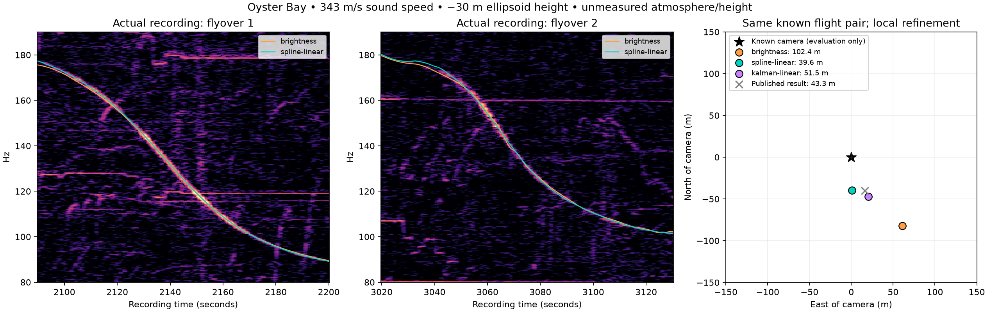

# Dopplertracker

**Find where a recording was made from the sound of aircraft flying past.**

A propeller plane's pitch drops as it passes a microphone. The exact shape of that
drop depends on where the microphone is relative to the flight path. Dopplertracker
measures those curves in the audio, compares them with public ADS-B flight tracks,
and solves for the microphone's location.

Based on the method shown in [colsto's YouTube video](https://www.youtube.com/watch?v=UytYrhYLOKI).



*Two real flyovers from a one-hour recording in Oyster Bay, New York. Left and
middle: fitted Doppler curves over the spectrogram. Right: estimated locations
relative to the true camera position.*

## Results

**Real recording** (one hour of audio, Oyster Bay, NY):

| Method | Error from true location |
|---|---:|
| Brightness baseline (this repo) | 102.4 m |
| Published result of the original [dopplertrack](https://github.com/mjshiggins/dopplertrack) (not rerun here) | 43.3 m |
| **Spline trajectory + linear source (this repo)** | **39.6 m** |

The spline method also ranks the correct pair of flights first out of 311
candidates. The brightness baseline ranks it second.

**Synthetic held-out benchmark** (95 scenes across 20 conditions such as noise,
wind, engine RPM drift, track gaps and interference):

| Metric | Brightness baseline | Spline + linear source |
|---|---:|---:|
| Estimates within 100 m | 81.1% | **94.7%** |
| 90th-percentile error | 232.7 m | **45.5 m** |
| Median error | **1.6 m** | 3.9 m |
| Median fit time | 2.13 s | **0.17 s** |

How to read these numbers:

- **One real recording.** It was also used for debugging, and the test starts from
  the original project's published event windows and candidate shortlist. It is not
  a blind search.
- **The edge over 43.3 m is not meaningful.** The spline result moves between
  39.6 m and 86.0 m depending on the assumed microphone height and sound speed.
- **The gain is in the bad cases.** The spline method cuts large errors, but the
  baseline has the better median, and the spline method does worse when the
  flyover measurements it starts from are wrong.

Details: [real-recording study](docs/oyster-bay-results.md) ·
[synthetic study](docs/accuracy-expansion.md) ·
[interactive report](docs/results/stress/report.html) (download and open locally)

## Quick start

Requires Python 3.11+ and [uv](https://docs.astral.sh/uv/). `ffmpeg` is only needed
for real audio or video.

```bash
git clone https://github.com/MarkShi17/dopplertracker.git
cd dopplertracker
uv sync
```

Run the whole pipeline on generated data. No downloads needed.

```bash
# 1. Generate a synthetic recording with three flyovers
uv run dopplertrack demo --scenario rpm_drift --out outputs/demo

# 2. Search a region for the microphone
uv run dopplertrack search outputs/demo/spectrogram.npz \
  --events outputs/demo/events.json --traces outputs/demo/traces.npz \
  --bbox 39.995 40.005 -73.006 -72.994 --spacing 200 \
  --elevation 0 --raw-score --out outputs/demo/search.json

# 3. Refine the best candidates
uv run dopplertrack refine outputs/demo/spectrogram.npz outputs/demo/search.json \
  --events outputs/demo/events.json --traces outputs/demo/traces.npz \
  --elevation 0 --raw-score --method projected --smooth spline --source-degree 1 \
  --out outputs/demo/refined.json
```

The refined position lands about 1 m from the true one in `outputs/demo/truth.json`.
That file is written for scoring only; search and refine never read it.

## How it works

1. **Spectrogram.** Decode the audio into a high-resolution low-frequency
   spectrogram (40–450 Hz, 0.25 Hz bins).
2. **Find flyovers.** Detect the S-shaped Doppler curves and fit each one's speed,
   distance and time of closest approach.
3. **Get flight tracks.** Download public ADS-B history for that day and region.
4. **Search.** Score candidate locations and flights against the audio, with every
   flyover locked to one shared recording clock.
5. **Refine and validate.** Fit the location continuously, then check that the
   match is supported by the audio rather than by noise.

Sound takes time to arrive, so the model solves *reception time = emission time +
travel time* and uses the aircraft's velocity at the moment the sound was emitted.

## Commands

| Command | What it does |
|---|---|
| `spectrogram` | Decode audio or video into a spectrogram |
| `detect`, `fit` | Find flyovers automatically, or fit one known window |
| `fetch-day`, `extract-region` | Download or extract regional ADS-B flight tracks |
| `search`, `search-single` | Score candidate locations against real flight tracks |
| `refine` | Continuously refine the best candidates |
| `validate` | Check a saved candidate against frequency-shifted null curves |
| `demo` | Write synthetic inputs for the quick start |
| `benchmark`, `stress-benchmark`, `controls-benchmark` | Reproduce the method comparisons |

Run `uv run dopplertrack <command> --help` for options.

## Use it on a real recording

```bash
uv run dopplertrack spectrogram recording.mp4 data/recording.npz
uv run dopplertrack detect data/recording.npz --band 60 300 --top 2 --out data/events.json
uv run dopplertrack fetch-day 2026-09-08 data/traces.npz --bbox 40.4 41.3 -74.4 -72.6
uv run dopplertrack search data/recording.npz --events data/events.json \
  --traces data/traces.npz --bbox 40.4 41.3 -74.4 -72.6 --spacing 200 \
  --terrain --geoid-offset -30 --out outputs/search.json
uv run dopplertrack refine data/recording.npz outputs/search.json \
  --events data/events.json --traces data/traces.npz \
  --terrain --geoid-offset -30 --method projected --smooth spline --source-degree 1 \
  --out outputs/refined.json
```

A daily flight archive is several GB. Check the detected flyovers before a large
search, and replace `-30` with your local geoid offset. The
[usage guide](docs/usage.md) covers each step, the options and the file formats.

## Reproduce the benchmarks

```bash
# Synthetic held-out study: 27 methods x 20 conditions x 5 seeds (about 7 minutes)
uv run dopplertrack stress-benchmark --split held-out --workers 4 \
  --seeds 100 101 102 103 104 --out outputs/stress

# Detection, flight ranking, audio and false-match controls
uv run dopplertrack controls-benchmark --out outputs/controls

# Tests
uv run pytest
```

The real-recording study needs the audio and a 3.9 GB flight archive. See
[how to reproduce it](docs/oyster-bay-results.md#reproduce).

## Limitations

- **Not a blind search yet.** The benchmarks supply the flights and approximate
  flyover windows. Automatic detection and large-region search are not validated
  on real recordings.
- **One real recording.** Field accuracy needs more recordings with known answers.
- **Stationary microphone.** Moving recorders are not supported.
- **Simple atmosphere.** Constant sound speed and uniform wind, with no refraction
  or echoes.
- **No guarantee of a correct match.** The evidence check is a heuristic, not a
  calibrated probability.

## Documentation

- [Usage guide](docs/usage.md): full workflow, options and file formats
- [Real-recording study](docs/oyster-bay-results.md): Oyster Bay results and failed experiments
- [Synthetic accuracy study](docs/accuracy-expansion.md): 27 methods, 20 conditions
- [Original experiments](docs/experiments.md): the first seven-method comparison
- [Design notes](docs/design.md): physics and modelling choices

## Credits

This is an independent reimplementation of the method shown in
[colsto's video](https://www.youtube.com/watch?v=UytYrhYLOKI) and the original
[dopplertrack](https://github.com/mjshiggins/dopplertrack) project. It is not a
fork, and its file formats are not compatible with that project. The 43 m and
592 m field results quoted there belong to that project.

- Flight data: [adsb.lol historical archive](https://github.com/adsblol/globe_history_2024),
  under the ODbL. Follow its terms when redistributing data.
- [readsb trace format](https://github.com/wiedehopf/readsb/blob/dev/README-json.md#trace-jsons)
- [Terrarium elevation tiles](https://github.com/tilezen/joerd/blob/master/docs/formats.md)
- [SciPy robust least squares](https://docs.scipy.org/doc/scipy/reference/generated/scipy.optimize.least_squares.html)
