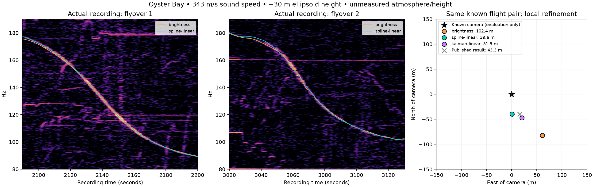

# Real-video evaluation: Oyster Bay

**The corrected spline/linear method reaches 39.6 m error on the actual recording,
versus 102.4 m for our brightness refinement.** It also ranks the correct flight
pair first when refining all 311 usable candidates from the published shortlist.
The published implementation's result is 43.3 m; our 3.7 m advantage over that
number is small and does not survive every height/sound-speed assumption.

This is development evidence on one known example. It is **not a new blind regional
search**, an independent reproduction of the other implementation, or a fully
automatic audio-to-location benchmark.



## Inputs and comparison protocol

We used the actual [one-hour raw recording](https://www.youtube.com/watch?v=4CxVxuMVkMc)
from the video: September 8, 2026, Oyster Bay, New York. Its downloaded Opus audio
is 3,600 seconds long. A four-second STFT with half-second hops gives 7,193 frames
and 1,641 bins over 40–450 Hz. Each scoring run whitens the raw power once.

The [pinned production flight archive](https://github.com/adsblol/globe_history_2026/releases/tag/v2026.09.08-planes-readsb-prod-0)
contains two verified parts totaling 3,874,165,248 bytes. Regional extraction
produced 13,077 segments. Geometric altitude is required; pressure altitude is not
silently substituted. No aircraft-class filter was applied during extraction.

Published event measurements, coarse candidates and baseline results come from
[`mjshiggins/dopplertrack` at a16b7006](https://github.com/mjshiggins/dopplertrack/tree/a16b7006dfe38b4880919ca2652f402342686289).
The two windows are 2090–2200 and 3020–3130 seconds. The reference flight identities
are `a1dfeb` / N22NY and `ace391` / N93CQ. Automatic event detection is not part of
this comparison: our unconstrained second-window ideal fit can select a competing tone.

The local refinement comparison initializes every method at the same published
coarse winner, 123.2 m from the known camera. It trims each flight to its event
window plus 120 seconds on both sides. At that fixed position, a shared clock
sweep of ±4 seconds and independent source-frequency sweeps of ±12 Hz calibrate
the starting candidate. Every event remains locked to one recording clock.

Before fitting, the scripts write the methods, assumptions and source hashes to
`plan.json`. Camera coordinates enter only the evaluation after all fits finish.
The starting pair and coarse position are nevertheless supplied by published
results, so this comparison measures conditional refinement. The previously
tested spline/linear preset was not selected by minimizing this clip's error.
Debugging on this clip makes it development data, not a held-out recording.

Primary assumptions are 343 m/s sound speed, zero wind and −30 m ellipsoid observer
height. The height approximates a sea-level shore with a geoid correction; neither
actual camera height nor atmospheric conditions was measured. Constant height is
also used for competing shortlist positions, which limits the regional comparison.

## Nine methods, four physical assumptions

Horizontal errors in meters; smaller is better. Each cell is a separate fit with
the same data and common initialization protocol. All 36 fits completed.

| Method | −30 m, 343 m/s (primary) | −30 m, 340 m/s | 0 m, 343 m/s | 0 m, 340 m/s |
|---|---:|---:|---:|---:|
| Brightness refinement | 102.4 | 104.6 | 117.9 | 125.2 |
| Local spectral contrast | 105.9 | 145.3 | 106.3 | 139.3 |
| Previous ridge fitter | 79.0 | 103.3 | 76.1 | 114.3 |
| Previous ridge + source drift | 114.6 | 144.1 | 92.3 | 139.7 |
| Projected constant source | 83.0 | 99.6 | 76.0 | 90.7 |
| Projected linear source | 82.0 | 109.7 | 88.7 | 121.2 |
| **Spline trajectory + linear source** | **39.6** | **86.0** | **58.7** | **64.6** |
| Kalman trajectory + linear source | 51.5 | 71.4 | 57.8 | 82.8 |
| Spline + blocked source-model selection | 109.5 | 108.4 | 108.7 | 93.4 |

The primary spline result reduces error by 61.3% relative to our brightness
refinement. It improves over our brightness baseline in all four tested physical
conditions, but is not the best method in every column. Its 39.6–86.0 m spread
shows why a 3.7 m improvement over the published 43.3 m is not strong evidence of
general superiority. The published baseline was evaluated from its saved highest-
scoring row, not rerun using our input loader, interpolation or scoring.

Automatic source-model selection chose a constant source in the primary case and
missed the better location. Allowing source drift without trajectory smoothing
also did not help. These negative results are retained in the artifacts.

## Does it choose the right flights?

We rescored every one of the published 328 best-per-flight-pair candidates. Seventeen
lacked sufficient geometric-altitude data under our import policy, leaving 311.
These exclusions are saved individually, not counted as successful eliminations.
Both coarse brightness and coarse contrast placed the correct pair second.

Next we refined **every usable pair with three methods: 933 fits**. Each method
started from that pair's same brightness-calibrated coarse candidate. Fits were
ranked by their own audio score, never by distance to the answer. Brightness uses
brightness; both projected methods use local contrast. Scores across different
methods are not directly comparable.

| Method | Correct pair rank / 311 | Winning location error | Correct-pair location error |
|---|---:|---:|---:|
| Brightness | 2 | 70,856 m | 102.4 m |
| Projected constant source | 2 | 70,888 m | 83.0 m |
| **Spline trajectory + linear source** | **1** | **39.6 m** | **39.6 m** |

The spline winner scores 1.500904 versus 1.426846 for the best wrong pair, a 5.19%
margin relative to the runner-up. Its result agrees with the conditional comparison.
The wrong runner-up is roughly 71 km away. All 933 fits returned results.

The evidence gate accepts 12 brightness candidates, 13 projected-constant candidates
and 19 spline candidates, including several wrong locations. Accepted-only ranking
does not change the correct pair's rank. This gate detects unsupported curves; it
does **not** prove a location or supply a calibrated false-match probability.

This experiment inherits the reference project's candidate generation and its
best point per flight pair. It cannot establish recall of our own regional search
or account for discarded positions within those flight pairs. A fresh search may
produce additional competitors. The 17 missing pairs also prevent a complete
328-pair ranking claim.

## What the real recording exposed

The first real comparison was worse: spline/linear missed by **593.2 m**, versus
102.4 m for brightness. That failed run remains in
[before-cadence-fix.json](results/oyster-bay/before-cadence-fix.json).

The trajectory smoother estimated position noise with second differences, which
assumed evenly spaced ADS-B reports. The real King Air reports arrive at intervals
from about 1.6 to 19.9 seconds. Unequal intervals make even constant velocity look
like position noise. The estimator reported 29.5 m east / 70.1 m north noise and
smoothed away trajectory details that carry location information.

The corrected estimator compares each position with the time-weighted interpolation
of its two neighbors and normalizes by the variance expected from independent
position noise. Constant velocity then produces zero residual regardless of report
cadence. Estimated east/north noise on that flight falls to about 5.25 / 5.28 m.
This is a generic timing correction, not a coordinate adjustment toward the camera.
It still assumes locally smooth motion; acceleration can contaminate a position-
noise estimate, and smoothing remains a model choice.

Twelve regression cases cover three random irregular schedules, two known noise
levels and both spline/Kalman consumers. Earlier real-input work also fixed
gain-dependent whitening and made archive downloads resumable and checksum-verified.

Final verification: **231 tests passed**; Ruff lint and formatting passed; wheel
and source distribution built. The final 36-fit run reproduced every earlier
corrected-run error to within 1e-9 m after refreshing source-hash provenance.

## Reproduce

Run from the repository root after the existing download script has prepared inputs:

```bash
bash scripts/fetch_video_example.sh
.venv/bin/python scripts/compare_oyster_bay.py --out outputs/oyster-bay/comparison-final
.venv/bin/python scripts/rerank_oyster_bay.py
.venv/bin/python scripts/refine_oyster_shortlist.py
.venv/bin/python -m pytest -q
```

The download command reuses verified cached parts. `uv run python` can replace
`.venv/bin/python` after a normal `uv sync`. The optional
`scripts/plot_oyster_bay.py --comparison outputs/oyster-bay/comparison-final` requires
matplotlib; it reads frozen fit results and does not refit them. The original failed
run cannot be regenerated with the fixed estimator; its saved source hashes and
outputs preserve what was measured.

Full records include settings, source hashes, raw fitted parameters, evidence
decisions, failures and evaluation errors:

- [36-fit refinement JSON](results/oyster-bay/refinement.json) and [CSV](results/oyster-bay/refinement.csv).
- [328 attempted coarse candidates](results/oyster-bay/coarse-shortlist.json).
- [933 shortlist refinements](results/oyster-bay/refined-shortlist.json) and [ranked CSV](results/oyster-bay/refined-shortlist.csv).
- [Input hashes](results/oyster-bay/inputs.json), [published baseline check](results/oyster-bay/published-baseline.json), and [published provenance](results/oyster-bay/published-provenance.json).

The next independent accuracy test should freeze these choices before processing
another recording. A new blind regional search and automatic event selection are
separate, still-unvalidated claims for this real example.
